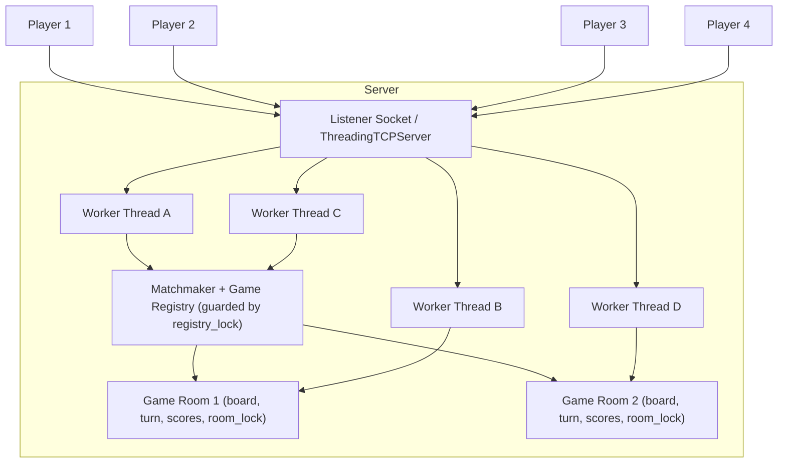

# Server Concurrency & Game Behavior Architecture Design

**Project:** Tic-Tac-Toe 
**Sprint:** Sprint 2 — Game Behavior & Server Concurrency Architecture Design
**Author:** Abdoul Kadre Tiemtore
**Date:** October 25 2026

## 1.Overview & Objectives

This document specifies the server-side architecture for a networked Tic-Tac-Toe game. The server must:

1. Accept **multiple simultaneous client connections**.
2. Synchronize **player turns and scores** between the two clients of each game.
3. Guarantee **thread safety** of all shared game state.
4. Validate every move on the server and broadcast consistent state to both clients.

## 2.Server Concurrency Model Selection

**Selected model: Option A: Multi-Threading** (`threading.Thread` or `socketserver.ThreadingTCPServer`)

### 2.1 Justification

| Criterion | Multi-threading | Non-blocking I/O multiplexing |
| --- | --- | --- |
| Implementation complexity | One blocking thread per client | Manual event loop |
| Fit for turn based, low frequency messages | Moves arrive rarely; blocking reads are natural | Excessive for only two clients per room |
| Shared state synchronization | Explicit `threading.Lock` per game room | Single-threaded, no locks, but complex state machine |
| Scalability to thousands of connections | Moderate | Excellent |
| Required for this game's scale (2 clients/room, few rooms) | Sufficient | Not needed |

For a simple classroom demo like Tic-Tac-Toe, a thread-per-connection model is much more practical than an event loop. Since the game is turn-based and clients only exchange a few short messages, the code stays clean and easy to debug. We don't need to worry about the overhead of managing threads because the project's scale is too small for thread limits to ever matter.

### 2.2 Architecture

- **Main thread:** runs the `ThreadingTCPServer` accept loop (`server_forever()`); one thread is spawned per accepted connection.
- **Matchmaker:** pairs waiting clients into game rooms; protected by a global `registry_lock`.
- **Game room:** an isolated object holding one game's state (board, current turn, scores, both client sockets). Each room owns its own `threading.Lock`, so games never contend with each other.

### 2.3 Shared State & Thread Safety

All mutable shared state and its protection strategy:

| Shared structure | Accessing threads | Protection |
| --- | --- | --- |
| Game registry (room list, waiting queue) | All worker threads, accept loop | `registry_lock` (global `threading.Lock`) |
| Board (3×3 grid), per room | The room's 2 worker threads | `room_lock` (`threading.Lock` per room) |
| Turn pointer (whose move) | The room's 2 worker threads | `room_lock` |
| Scoreboard (wins per player, per room) | The room's 2 worker threads | `room_lock` |
| Client socket send paths | Both worker threads of a room | `room_lock` (serializes broadcasts) |

**Rules enforced by the design:**

1. **No unsynchronized read or write** of board, turn, or scores: every mutation occurs inside a `with room_lock:` block.
2. **Coarse-grained per-room locking:** a single lock per room covers validate → update → broadcast as one atomic critical section. This eliminates race conditions such as two clients moving simultaneously, because validation and mutation are indivisible.
3. **No cross-room contention:** each room has its own lock, so concurrent games proceed in parallel.
4. **Lock ordering:** only two lock types exist; a worker acquires `registry_lock` only during match-making and releases it *before* acquiring `room_lock`, guaranteeing no deadlock.
5. **Timeouts:** connections use `socket.settimeout()` to avoid a hung client blocking a thread forever.
6. **Cleanup:** when a player disconnects, the worker thread signals the room, broadcasts a forfeit/win, and removes the room from the registry under `registry_lock`.

## 3. Game Behavior Logic

### 3.1 Turn Synchronization

The server is the single source of truth for turn order. Each `MOVE` request is validated against the server's authoritative turn pointer:

1. Is the sender the current player? If not → `ERROR "Not Your Turn"`.
2. Is the target cell empty and in range? If not → `ERROR "Invalid Move"`.
3. Apply the move, check win/draw, flip the turn pointer.
4. Broadcast `STATE_UPDATE` (board + current turn) to both clients.

Turn pointer updates and board updates happen atomically inside `room_lock`, so a client acting twice quickly cannot make two moves.

### 3.2 Score Handling

Each room tracks a scoreboard (`{X: n, O: n, draws: n}`). After a win or draw, the room increments the score under `room_lock`, includes it in the final `STATE_UPDATE`, and offers a rematch. The scoreboard is never held in the clients; clients only render what the server sends.

### 3.3 Protocol (newline-delimited JSON over TCP)

| Message | Direction | Fields |
| --- | --- | --- |
| `JOIN` | Client → Server | `name` |
| `MOVE` | Client → Server | `row`, `col` |
| `STATE_UPDATE` | Server → Clients | `board`, `turn`, `scores`, `status` |
| `ERROR` | Server → Client | `message` (`"Invalid Move"` or `"Not Your Turn"`) |
| `GAME_OVER` | Server → Clients | `winner`, `scores` |

See `sequence_diagram.md` for the full message-flow diagrams.

## 4. Risks & Mitigations

| Risk | Mitigation |
| --- | --- |
| Race condition on board/turn | Per-room `threading.Lock`; validate+update+broadcast in one critical section |
| Deadlock | Strict lock ordering; never hold `registry_lock` while acquiring `room_lock` |
| Thread leak from hung clients | Daemon threads + `socket.settimeout()` |
| Slow client blocks the other player | Broadcasts are quick, fixed-size messages; timeouts on send |

## 5. Acceptance Criteria Mapping

- ✅ **Simultaneous client connections:** thread-per-connection via `ThreadingTCPServer`; multiple rooms run in parallel.
- ✅ **Documented thread safety:** Section 2.3 enumerates every shared structure and its lock.
- ✅ **Turn/score synchronization:** Sections 3.1–3.2; diagrams in `sequence_diagram.md`.
- ✅ **Server-side move validation:** Sections 3.1 and the sequence diagrams.