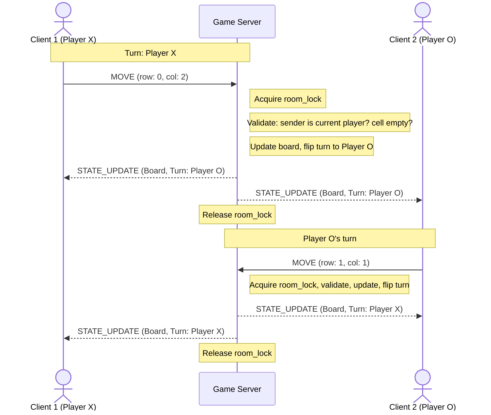
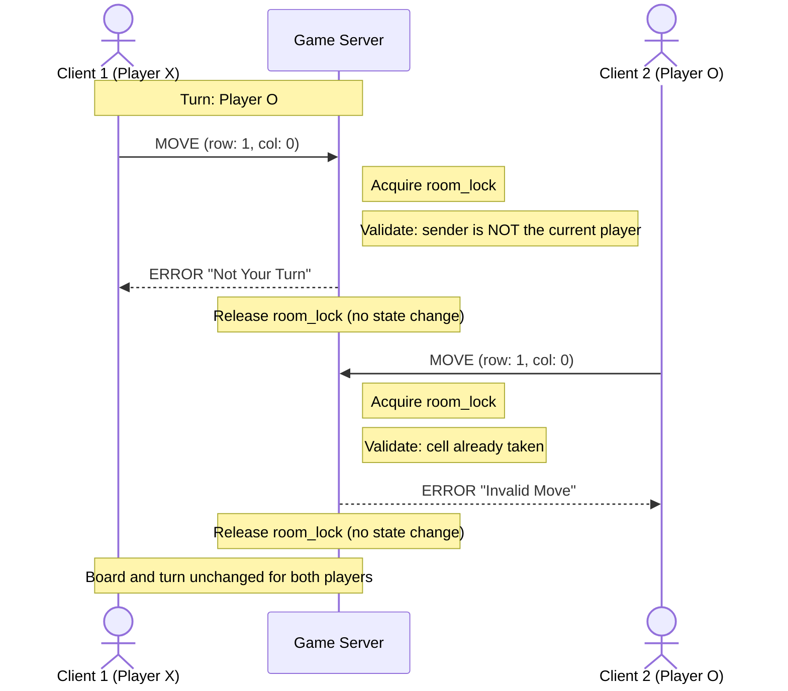
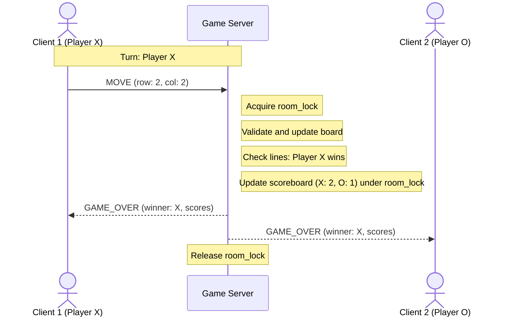
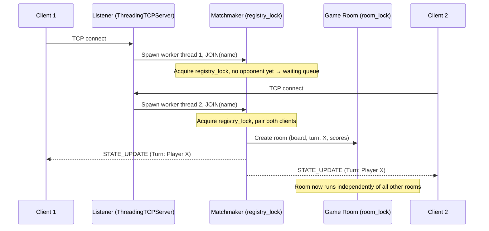

# Message Flow Sequence Diagrams — Tic-Tac-Toe Server

**Project:** Tic-Tac-Toe 
**Sprint:** Sprint 2 — Game Behavior & Server Concurrency Architecture Design
**Author:** Abdoul Kadre Tiemtore

Companion to `concurrency_design.md`. All diagrams use **Mermaid** syntax and render directly on GitHub.

## 1.Turn Synchronization

A move by Player X (Client 1) is validated, applied, and the new state is broadcast to both clients inside a single locked critical section on the server.

## 2.Invalid Move / Not Your Turn Flow

The server rejects the request with `ERROR` and the authoritative state is unchanged.

## 3.Win Detection & Score Broadcast

## 4.Connection & Matchmaking

Two clients connect concurrently; the server spawns one worker thread per connection, pairs them into a room under `registry_lock`, then each room runs independently.

- All validation, board mutation, and broadcasts happen server-side inside the room's `threading.Lock` critical section — see `concurrency_design.md` §2.3 and §3.1.
- The two `ERROR` cases (`"Invalid Move"`, `"Not Your Turn"`) leave the authoritative state untouched, so both clients stay consistent.
- Diagrams were validated with the Mermaid Live Editor (mermaid.live) and render natively on GitHub.